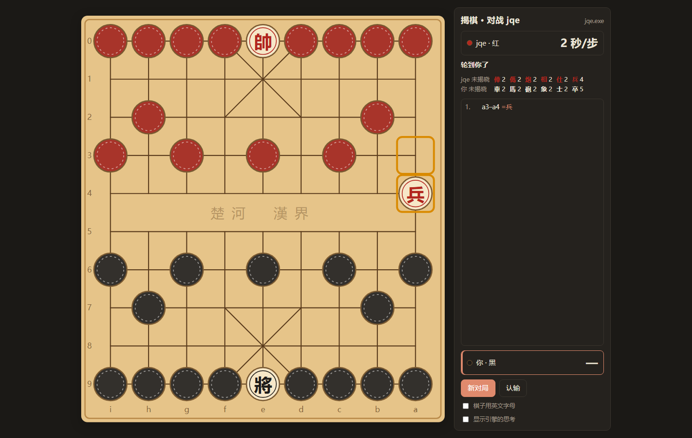
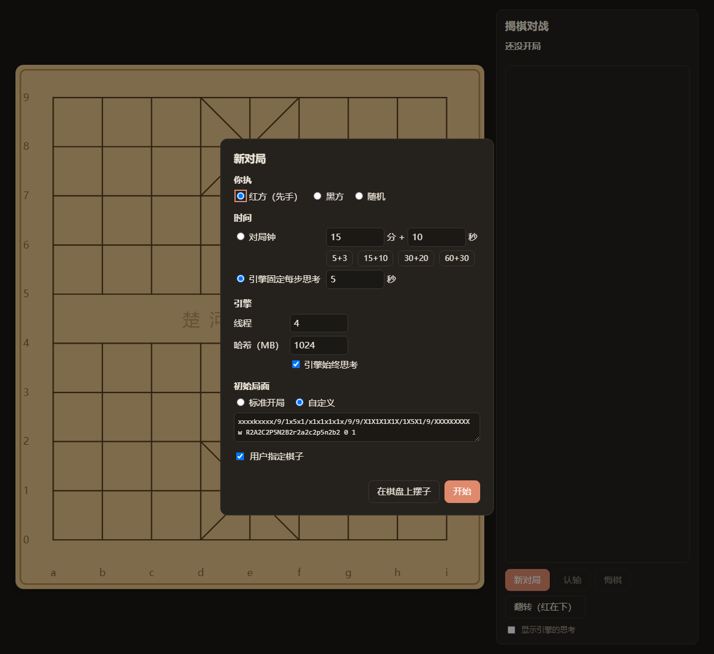
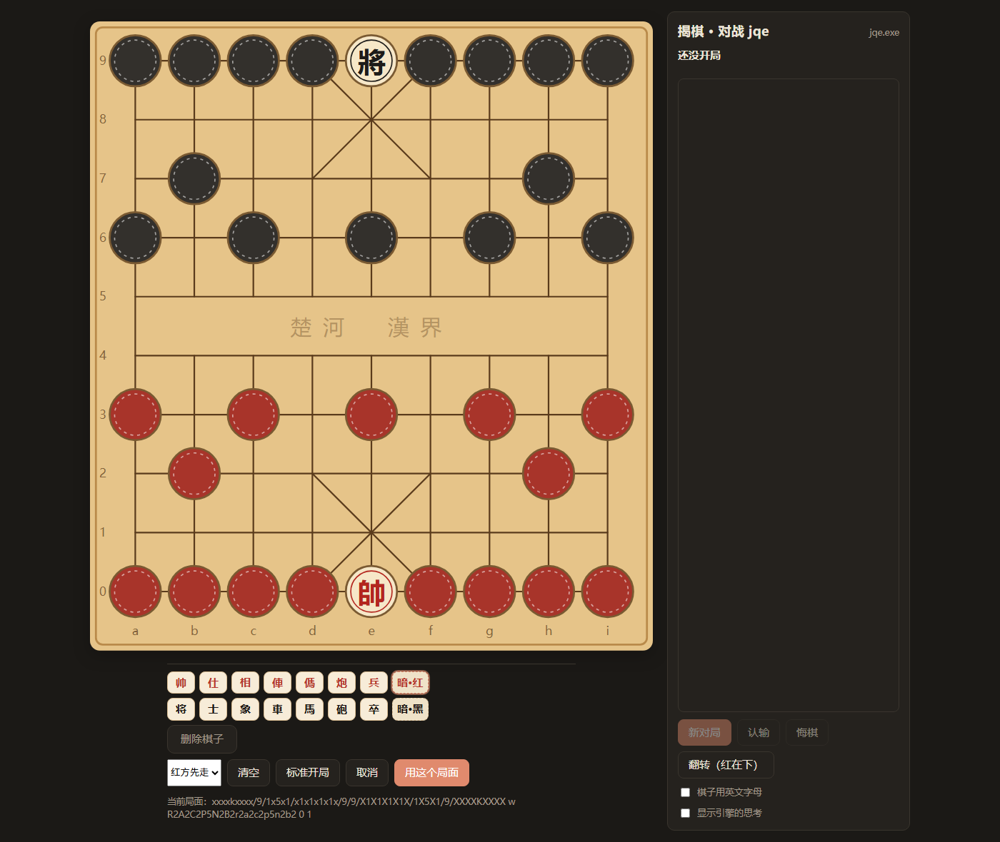
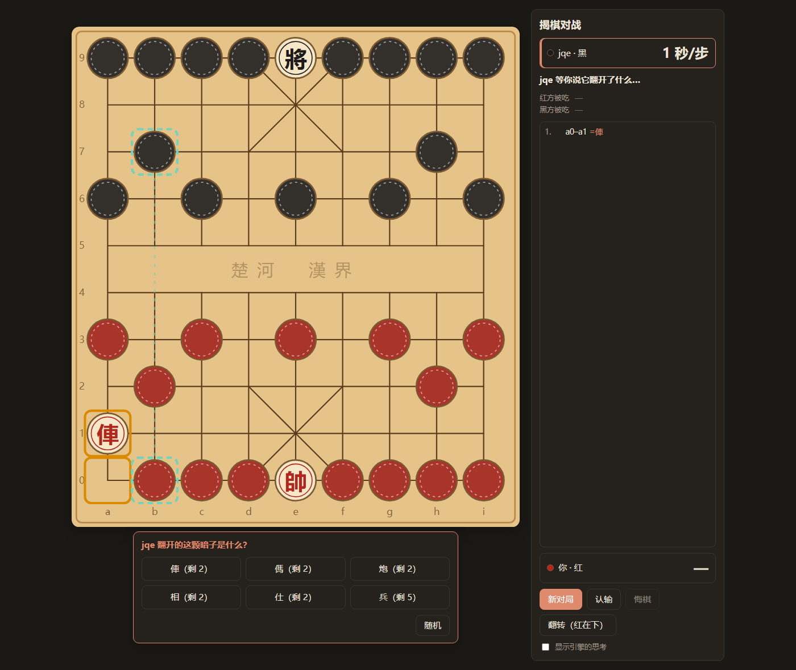
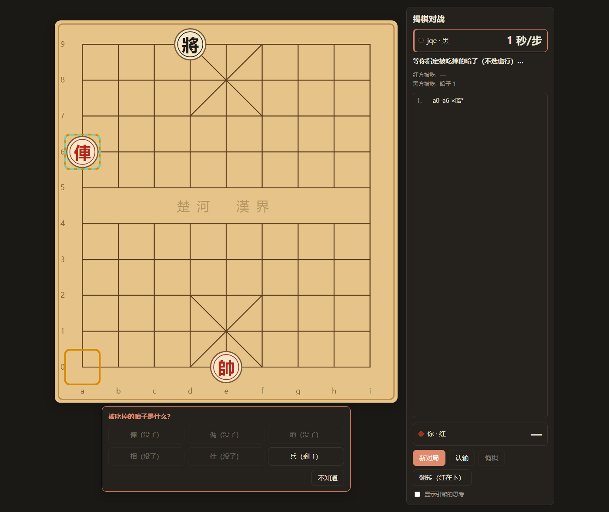

# 揭棋对战 · jqe 中文界面版

**中文** | [English](README.en.md)

[jqe](https://github.com/devinokeefe/jieqi) 是一个开源揭棋引擎（C++20 自对弈 NNUE，作者 Devin O'Keefe，MIT）。
本仓库在它自带的本地对局界面（`engine/tools/play.py` + `play.html`）上做了中文界面与交互改造：
**汉化、翻转、悔棋、自定义局面与摆子、暗子身份指定、被吃子面板**。

引擎与裁判库是上游原样代码，直接运行即可；改造范围与许可说明见 [NOTICE.md](NOTICE.md)。



## 直接下载（免编译，推荐）

只想下棋、不想折腾环境的话，走这条：

1. 打开 [Releases](../../releases) 下载 **`揭棋对局.zip`**（约 11 MB）；
2. 解压到任意目录（路径里尽量不要有 `%TEMP%` 之类的特殊目录）；
3. 双击 **`揭棋对战.exe`**，浏览器会自动打开 `http://localhost:8765`。

这个包是 PyInstaller 打的自包含版本：**不需要安装 Python**，不需要编译器，也不需要单独下载引擎与权重（`jqe.exe`、`it014.jqn`、`jieqi_rules.dll` 都已在包内）。

- 不想自动开浏览器：`揭棋对战.exe --no-open`
- 换端口（比如 8765 被占用）：`揭棋对战.exe --port 8800`
- 关掉：关掉那个黑色控制台窗口即可，没有后台服务常驻。

想改代码、或者要自己编译引擎，看下面「从源码运行」。

## 功能

- **人机对战**：想享受纯粹的人机对战，在开启新对局时，无需勾选最下方“用户指定棋子”
- **自定义对局**
- **指定揭棋棋子**：常见于特殊的对战场景，勾选最下方“用户指定棋子”（默认）

| 新对局 | 摆子 |
| --- | --- |
|  |  |

| 翻开暗子由你选 | 指定被吃的暗子 |
| --- | --- |
|  |  |

## 从源码运行（Windows）

需要：**Python 3.11+**（`play.py` 用了 `enum.StrEnum`）、一个 C++20 编译器（MSYS2 UCRT64 的 g++ 即可）。

```bat
:: 1) 编译裁判库（必须静态链接，见下文“踩过的坑”）
cd native
g++ -std=c++20 -O2 -shared -DJIEQI_BUILD_DLL -I include -static -static-libgcc -static-libstdc++ ^
    -o ..\build\bin\jieqi_rules.dll c_api.cpp rules.cpp repetition.cpp chase.cpp

:: 2) 编译引擎
cd ..\engine\src
g++ -std=c++20 -O3 -DNDEBUG -march=native -pthread -I. -static -lpthread ^
    -o ..\build-manual\jqe.exe main.cpp uci.cpp selfplay.cpp tables.cpp position.cpp ^
    eval.cpp nnue.cpp search.cpp

:: 3) 启动界面（会自动找 Python、设 JIEQI_NATIVE_LIBRARY、带上引擎与权重）
cd ..\..
运行对局界面.bat
```

浏览器打开 <http://localhost:8765> 即可。也可以手动：

```bash
set JIEQI_NATIVE_LIBRARY=build\bin\jieqi_rules.dll
python engine\tools\play.py --port 8765 --engine engine\build-manual\jqe.exe --net engine\nets\it014.jqn
```

`play.py` 的参数：`--port`（端口）、`--engine`（引擎可执行文件）、`--net`（权重）、`--no-open`（不自动开浏览器）。

## 踩过的坑（Windows）

- `play.py` 默认找 Linux 的 `.so`，Windows 上必须设 `JIEQI_NATIVE_LIBRARY` 指向 `jieqi_rules.dll`。
- 裁判库**必须静态链接** `-static -static-libgcc -static-libstdc++`，否则加载时缺 libstdc++-6.dll。
- MinGW 缺 `std::aligned_alloc`：上游 `engine/src/mem.h` 用了它，用 MSYS2 的 g++ 15 编译会失败；
  把分配/释放换成 `_aligned_malloc` / `_aligned_free` 即可（**两边必须成对换**，只换分配会崩）。
- PATH 上的 `python` 可能是 3.8，会报 `cannot import name 'StrEnum'`；`运行对局界面.bat` 会自己挑 3.11+ 的解释器，
  也可以用 `set JIEQI_PY=C:\Python311\python.exe` 指定。

## 许可

- 本仓库的改造部分与上游代码同为 **MIT**（见 [LICENSE](LICENSE)）。
- 上游版权：Copyright (c) 2026 Devin O'Keefe。
- 仓库**不含** GPL-3.0 的皮卡鱼揭棋二进制；详情与改动清单见 [NOTICE.md](NOTICE.md)。
- 引擎与评测的原始说明请读 [README.md](README.md)、[RULES.md](RULES.md)、[REPORT.md](REPORT.md)。
